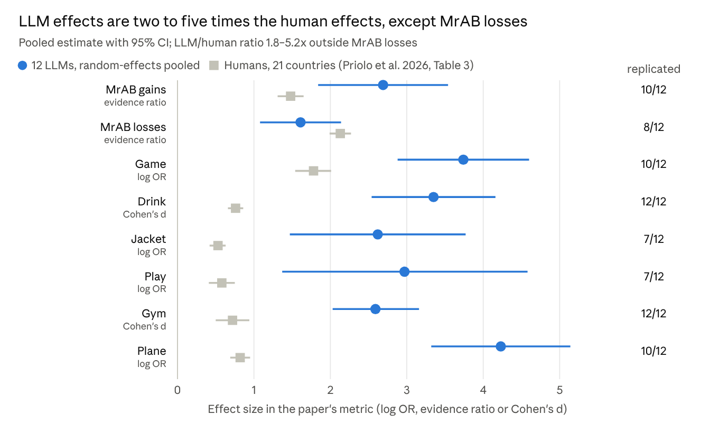
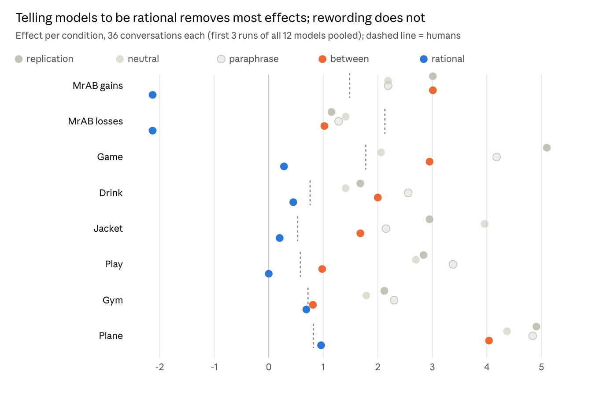

# Do Language Models Keep Mental Accounts?

## Replicating and probing Priolo et al. (2026) across twelve large language models

Oct 24, 2026 · Steffen · Working paper draft

## Abstract

Twelve large language models (LLMs) from twelve developers reproduce the direction of all seven mental accounting scenarios that Priolo et al. (2026) replicated in 5,589 people from 21 countries, but with effect sizes roughly two to five times larger than in humans. We administered the original survey (17 items, randomized block order, same exclusion rules and effect metrics) to each model via the OpenRouter API, treating models as the counterpart of countries and independent conversations as participants (155 conversations, 10–15 per model). 90 of 96 model-level effects pointed in the predicted direction and 76 (79%) met the paper's replication criterion, against 90.5% in humans; the gap mainly reflects small samples per model.

Four probe variants (144 further conversations) located the source of the effects. Removing the participant role left the effects largely intact. Rewritten scenarios with new stories and amounts left them intact as well, which argues against simple recall of the textbook items. An instruction to decide as a fully rational agent removed the fungibility and sunk-cost effects (Jacket, Play) and most transaction-utility effects, but not the effects that carry a social norm (Plane, Gym). Showing only one condition per conversation shrank Play and Gym to roughly human size. LLMs thus default to human-like mental accounting, can switch it off on request, and exaggerate it partly because their answers barely vary and partly because they see contrasting conditions side by side.

## 1 Introduction

Priolo et al. (2026) showed that mental accounting replicates across 21 countries: all seven scenarios replicated in a pooled hierarchical analysis and 90.5% of country-level effects reached 95% credibility. Their study offers what LLM research on economic behavior often lacks: a large, preregistered, multi-country human benchmark with fixed materials and effect metrics. We use it to ask whether LLMs, which are increasingly used as simulated respondents ("silicon samples") and as decision aids, keep the same mental accounts.

There are two plausible expectations. LLMs are trained on human text, so they may reproduce human framing effects. They are also trained to reason and to solve textbook problems, and the scenarios are textbook problems, so they may answer as the normative model prescribes. The scenarios also differ in whether a normative answer exists: Jacket and Play test fungibility, whereas MrAB asks how people *feel*, and Drink, Game and Plane involve social norms.

We address three questions:

1. **RQ1 – Replication.** Do LLMs show the seven mental accounting effects, and how large are they relative to the human pooled estimates?
2. **RQ2 – Source.** Do the effects depend on a participant role, on recognizing the published scenarios, or on the model not being asked to be rational?
3. **RQ3 – Design.** Does the within-subjects design, in which a model sees both conditions in one conversation, change the effects?

## 2 Method

We kept the human study's materials, flow, exclusions and effect metrics, and replaced countries with models and participants with independent conversations.

**Models.** One general-purpose model from each of twelve developers, all accessed through OpenRouter on 23–24 October 2026: OpenAI gpt-6-sol, Anthropic claude-sonnet-5.5, Google gemini-3.8-flash, Meta muse-spark-1.3, Mistral mistral-large-4-0, DeepSeek deepseek-v4.1-flash, Alibaba qwen3.8-max-0902, xAI grok-4.7, Moonshot kimi-k3, Zhipu glm-5.3, Cohere command-a-plus and MiniMax minimax-m3. Settings were identical: temperature 1.0 (two providers ignore the parameter and use their default), reasoning effort "low", up to 8,000 output tokens.

**Survey.** The 17 items of Table 1 in Priolo et al. (2026), verbatim in English with US-dollar amounts. Each conversation is one participant: one item per turn, earlier answers kept in context. Items came in four blocks (5/4/4/4) in random order, fixed order within blocks, never two conditions of one scenario in the same block. Four financial-literacy items and the data-quality question ("How serious have you been about filling in the survey?", 1–5) followed. Answers were requested as JSON; an unreadable answer was asked again up to twice.

**Exclusions.** As in the paper: incomplete surveys and data quality below 4 were excluded. Of 299 conversations, 3 were incomplete (one Cohere run, two DeepSeek runs whose reasoning used up the token limit); none reported low seriousness.

**Effect metrics.** As in the paper: evidence ratio against chance (1/9) for MrAB gains and losses; log odds ratio for Game (price at or above market value, stranger vs. friend), Jacket, Play and Plane; Cohen's d for Drink (log price) and Gym (agreement with "I wasted $20"). Binary outcomes use a +0.5 correction, the frequentist counterpart of the paper's weakly informative priors. An effect replicates when its 95% interval excludes zero in the predicted direction. Model estimates are pooled with a DerSimonian–Laird random-effects meta-analysis instead of the paper's hierarchical Bayesian model.

**Probe variants.** Each variant ran 3 conversations per model (36 per variant):

| Variant | Change from the replication | Question it tests |
| --- | --- | --- |
| Neutral | System prompt without the survey-participant role | Is the effect role play? |
| Rational | Instruction to decide as a fully rational agent who treats money as fungible and ignores sunk costs | Can the model switch the effect off? |
| Paraphrase | New stories and amounts with the same structure (concert, yoga class, train upgrade, $45 voucher) | Does the effect depend on recognizing the published items? |
| Between | One randomly chosen condition per scenario per conversation | Does seeing both conditions inflate the effect? |

Variants are compared on the first three runs of every model, pooled across models, so that sample size is equal across conditions.

**Deviations.** The country-adapted amounts, exact financial-literacy items and block file are on OSF and were not available; amounts follow Table 1 and the block assignment was reconstructed from the paper's description. Demographic and GDP analyses have no counterpart for models and were omitted. Total API cost was about $18.

## 3 Results: the effects replicate, and are inflated

All eight effects replicate in the pooled LLM estimate, and seven of them are 1.8 to 5.2 times as large as in humans; only the MrAB loss effect is smaller (1.61 vs. 2.13).

*Figure 1. Source: `results/meta.csv` (155 conversations, 10–15 per model) and Priolo et al. (2026), Table 3.*

At the model level, 90 of 96 effects point in the predicted direction and 76 (79%) meet the replication criterion, compared with 133 of 147 (90.5%) country-level effects in humans. The six exceptions are informative rather than noise: Cohere reverses the sunk-cost effect (64% would rebuy a lost ticket, 14% after losing the cash); GPT and Cohere never make the 20-minute trip in either Jacket condition, and MiniMax makes it equally often (13%) in both; Claude and DeepSeek show no MrAB loss pattern. MrAB losses are weak across models because most of them judge the person with the "silver lining" (car repair plus a small raffle win) as more upset, the opposite of Thaler's prediction.

Models differ far more than runs of one model. Heterogeneity is high for Drink, MrAB gains, Play and Gym (I² = 0.70–0.82), and many models give the same answer in every run (e.g., all twelve say yes in Play2). Meta, Kimi and Qwen replicate all eight effects; Claude and Mistral replicate the fewest. In the paper's own between-subjects check (first condition encountered), the mean model-level estimates stay large (log OR: Jacket 1.92, Play 2.10, Plane 3.60).

## 4 Results: where the effects come from

Only an explicit instruction to be rational removes the effects, and only those without a social norm; neither the participant role nor recognition of the published scenarios explains them.

*Figure 2. Source: `results/variants_effects.csv`; 36 conversations per condition (33 for rational); intervals omitted because they ignore clustering by model.*

**Role (neutral).** Without the survey-participant framing the effects stay at the replication level for six of eight effects. Game halves (5.10 to 2.06), but remains above the human value.

**Recognition (paraphrase).** With new stories and amounts the effects are as large as with the published wording (Drink 2.56, Play 3.38, Plane 4.84). Models apply the pattern, not a memorized answer to a known item. This does not rule out learning from the literature, since the paraphrases keep the canonical structure.

**Rationality (rational).** Under the instruction to treat money as fungible and ignore sunk costs, Play falls to 0.00 (every model rebuys the ticket in both conditions) and Jacket to 0.20; Game (0.28) and Drink (0.45) nearly vanish. In MrAB nearly all models answer "No difference", which turns the evidence ratios negative (−2.13): they decline to predict feelings rather than predicting them rationally. Two effects survive: Plane (0.96; 64% would pay for a bought voucher, 39% for a free one) and Gym (0.69). Both involve a norm about other people's money or about wasted effort.

**Design (between).** When a conversation sees only one condition, Play drops from 2.84 to 0.98 and Gym from 2.12 to 0.81, close to the human 0.58 and 0.72. Jacket and Game also shrink. Plane, Drink and MrAB barely change. Seeing both conditions side by side thus inflates some effects, apparently because the model contrasts them deliberately.

## 5 Discussion

LLMs do not behave as the normative economic model by default, although they can when told to. Their default is a human-like, and exaggerated, version of mental accounting.

**Normative rationality versus social norms.** The scenarios split into two groups. Where the normative answer is purely economic (Jacket, Play, Drink, Game), a rationality instruction removes the effect, so the models hold the normative rule but do not apply it unprompted. Where the "irrational" answer is also the socially appropriate one (paying a friend for a coupon they bought; feeling that a paid-for session was wasted), the effect survives the instruction. For these items mental accounting looks less like an error than like a norm the models treat as part of good judgement. MrAB is a third case: it asks how people feel, so a model that answers "No difference" under the rationality instruction has stopped predicting people rather than become more rational.

**Stereotyped humans.** For seven of eight effects, the pooled LLM estimate exceeds even the largest single-country estimate in Priolo et al.'s Figure 1 (read from the figure). Two mechanisms contribute. First, the models produce the modal human answer almost every time, so between-run variance is small and standardized effects become large; this is a property of sampling from one model, not of stronger bias. Second, the contrast between conditions is sharper than in humans, partly because a model that sees both versions in one conversation appears to emphasize their difference (Play and Gym fall to human size between subjects). The models seem to reproduce the textbook pattern rather than the distribution of human answers.

**Implications for silicon samples.** For direction, pooled LLM respondents would have predicted the human results correctly for all seven scenarios. For size, they would have overstated seven of eight effects severalfold and understated the MrAB loss effect, and their relative ordering of scenarios does not track the human ordering (model-level correlations with the human effect profile range from −0.90 to 0.33). Simulated respondents may be useful for piloting the direction of framing effects, not for estimating their magnitude or for power analyses. The large differences between models (I² up to 0.82) also mean that results from one model do not generalize to "LLMs".

**Implications for LLMs as advisors.** A user who asks a model for help with these decisions will, by default, get advice that reproduces mental accounting. The rationality instruction shows that the normative answer is available. Whether a model should apply it by default is a design question, since in the norm-laden scenarios the human-like answer may be the one users want.

## 6 Limitations and future work

The main limitation is sample size: 10–15 conversations per model in the replication and 3 per model and variant in the probes, against 250 per country in the human study.

- **Runs are not people.** Variation between conversations of one model is sampling noise, not population heterogeneity. Model-level intervals describe the stability of a model's behavior; they are not comparable to country-level intervals, and the 79% vs. 90.5% replication rates should not be read as a difference in robustness.
- **Variant comparisons are coarse.** Each condition has 36 conversations (33 for rational), between-subjects cells about 18; the pooled estimates ignore clustering by model. Only the large contrasts (rational vs. replication; Play and Gym between subjects) should be taken as findings.
- **Materials.** We used the Table 1 amounts in US dollars and English only, a reconstructed block assignment and standard financial-literacy items. The OSF materials would allow an exact replication, including the 23 languages and country-adapted amounts.
- **Settings.** All models ran with temperature 1.0 and low reasoning effort; two providers ignore the temperature parameter. Reasoning effort may well change the effects and is untested here.
- **Model snapshot.** The twelve models are October 2026 versions; providers update models without notice.
- **Paraphrases** keep the canonical structure of each scenario, so they test recognition of the wording, not knowledge of the effect itself.

Natural next steps are a preregistered run with 100+ conversations per model and variant, reasoning effort as a factor, the original languages, and scenarios with no published precedent.

## Data and code availability

Survey code, all raw transcripts (299 conversations with prompts, answers, order and cost) and analysis outputs are in the repository [hstre/The-Robustness-of-Mental-Accounting](https://github.com/hstre/The-Robustness-of-Mental-Accounting) (`data/raw/`, `results/`, `results/variants.md`). `python -m ma_llm analyze` and `python -m ma_llm compare` reproduce every number in this paper from the stored transcripts.

## References

Reference details below were compiled from memory and must be checked before submission; only Priolo et al. (2026) was consulted directly.

- Argyle, L. P., Busby, E. C., Fulda, N., Gubler, J. R., Rytting, C., & Wingate, D. (2023). Out of one, many: Using language models to simulate human samples. *Political Analysis*, 31(3), 337–351.
- Chinn, S. (2000). A simple method for converting an odds ratio to effect size for use in meta-analysis. *Statistics in Medicine*, 19(22), 3127–3131.
- DerSimonian, R., & Laird, N. (1986). Meta-analysis in clinical trials. *Controlled Clinical Trials*, 7(3), 177–188.
- Horton, J. J. (2023). Large language models as simulated economic agents: What can we learn from Homo silicus? NBER Working Paper 31122.
- Kahneman, D., & Tversky, A. (1982). The psychology of preferences. *Scientific American*, 246(1), 160–173.
- Lusardi, A., & Mitchell, O. S. (2014). The economic importance of financial literacy. *Journal of Economic Literature*, 52(1), 5–44.
- Priolo, G., Stablum, F., Vacondio, M., et al. (2026). The robustness of mental accounting across 21 countries. *Journal of Consumer Research*. <https://doi.org/10.1093/jcr/ucag022>
- Shafir, E., & Thaler, R. H. (2006). Invest now, drink later, spend never: On the mental accounting of delayed consumption. *Journal of Economic Psychology*, 27(5), 694–712.
- Thaler, R. H. (1985). Mental accounting and consumer choice. *Marketing Science*, 4(3), 199–214.
- Thaler, R. H. (1999). Mental accounting matters. *Journal of Behavioral Decision Making*, 12(3), 183–206.
- Tversky, A., & Kahneman, D. (1981). The framing of decisions and the psychology of choice. *Science*, 211(4481), 453–458.
